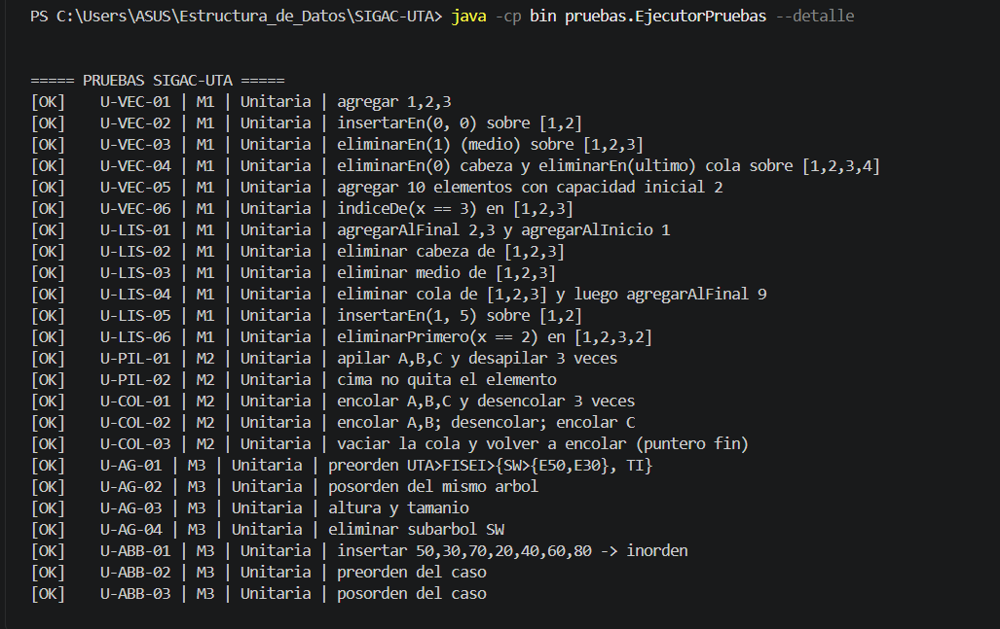
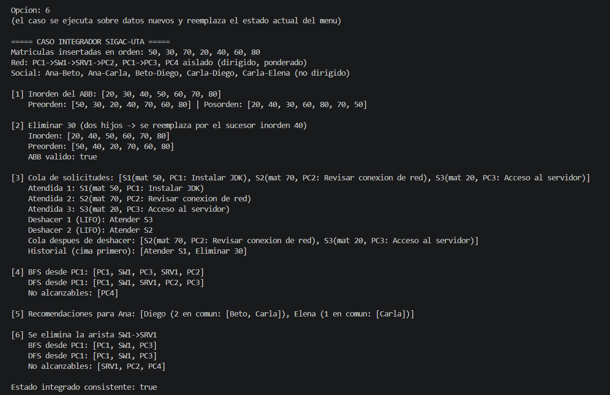
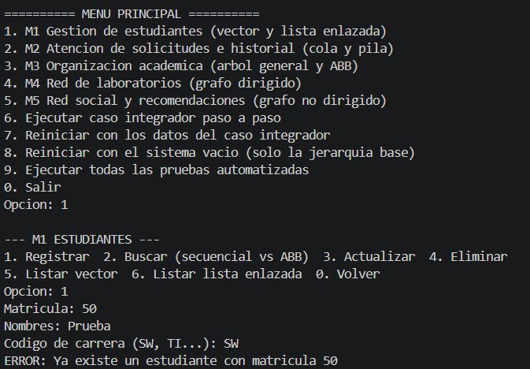

# SIGAC-UTA

Sistema Inteligente de Gestión Académica y Conectividad. Examen práctico integrador de Estructura de Datos, Ingeniería en Software (tercer nivel), FISEI, Universidad Técnica de Ambato.

Autor: Romel Fabricio Gamboa Araujo (trabajo individual).

El sistema gestiona estudiantes, la jerarquía académica, las solicitudes de laboratorio con su historial, una red de equipos y una red social de usuarios, todo en una sola aplicación.

`SistemaSIGAC` tiene una instancia de cada servicio y todos trabajan sobre el mismo estado. Por ejemplo, un estudiante nuevo entra al vector, a la lista, al ABB y al árbol general en la misma operación. Una solicitud solo se acepta si la matrícula existe en M1 y el equipo existe en M4.

Las estructuras centrales están hechas a mano en `src/estructuras`. No usé `TreeMap`, `TreeSet`, `ArrayList`, `LinkedList` ni librerías de grafos. Del JDK solo se usan `Scanner`, `Iterator`, `NoSuchElementException` y clases de entrada/salida. `estructuras.Vector` es mi propia clase, no `java.util.Vector`. `Vector` y `ListaEnlazada` implementan la interfaz `Iterable` solo para poder recorrerlas con for-each; los datos y los enlaces los manejo yo en cada clase.

## Estructura del proyecto

```
SIGAC-UTA/
├── src/
│   ├── app/          Main.java (menú) y DemoCasoIntegrador.java
│   ├── modelo/       Estudiante, UnidadAcademica, Solicitud, Operacion, Conexion, Equipo, Usuario, Recomendacion...
│   ├── estructuras/  Vector, ListaEnlazada, Pila, Cola, ArbolGeneral, ABB, Grafo y excepciones propias
│   ├── servicios/    ServicioEstudiantes, ServicioAtencion, ServicioAcademico, ServicioRedLaboratorio,
│   │                 ServicioRedSocial y SistemaSIGAC (integración)
│   └── pruebas/      Verificador propio, suites de prueba y EjecutorPruebas (ejecutor)
├── docs/
│   ├── matriz-pruebas.md
│   ├── contribuciones.md
│   └── capturas/
└── README.md
```

## Requisitos

JDK 8 o superior. No hace falta Maven, Gradle ni JUnit: las pruebas usan un verificador propio para que todo compile solo con `javac`.

## Compilar, probar y ejecutar

Todos los comandos se corren desde la carpeta raíz `SIGAC-UTA`. Con `-sourcepath src`, javac compila `Main` y `EjecutorPruebas` y va buscando solo las demás clases que usan, así no hace falta armar una lista de archivos. Esto también evita problemas si la ruta de la carpeta tiene espacios o tildes. Si algún día agrego una clase que ninguna otra usa, javac no la compilaría; hoy todas se usan.

### Windows (CMD)

```
if not exist bin mkdir bin
javac -encoding UTF-8 -d bin -sourcepath src src\app\Main.java src\pruebas\EjecutorPruebas.java
java -cp bin pruebas.EjecutorPruebas
java -cp bin app.Main
```

### Windows (PowerShell)

```
New-Item -ItemType Directory -Force bin | Out-Null
javac -encoding UTF-8 -d bin -sourcepath src src\app\Main.java src\pruebas\EjecutorPruebas.java
java -cp bin pruebas.EjecutorPruebas
java -cp bin app.Main
```

### Linux / macOS / Git Bash

```
mkdir -p bin
javac -encoding UTF-8 -d bin -sourcepath src src/app/Main.java src/pruebas/EjecutorPruebas.java
java -cp bin pruebas.EjecutorPruebas
java -cp bin app.Main
```

La carpeta `bin` se crea antes porque en JDK 8 `javac -d` no la crea sola (desde JDK 9 sí la crea).

Opciones del ejecutor de pruebas:

- `--detalle` muestra cada caso con `[OK]` o `[FALLA]`.
- `--matriz docs/matriz-pruebas.md` vuelve a generar la matriz con los resultados reales de esa ejecución.

Si alguna prueba falla, el ejecutor termina con código de salida 1.

## Menú

Al arrancar, `Main` carga los datos del caso integrador para poder demostrar todo de una vez. Desde el menú principal se entra a cada módulo (M1 a M5), se puede ejecutar el caso integrador paso a paso (opción 6, que arranca con datos nuevos y reemplaza lo que había en el menú), reiniciar el sistema con los datos del caso o vacío (7 y 8) y correr todas las pruebas (9). Las entradas no numéricas o vacías se vuelven a pedir, y los errores de validación se muestran como `ERROR: ...` sin cerrar el programa.

## Módulos

| Módulo | Estructuras | Dónde está |
|---|---|---|
| M1 Gestión de estudiantes | `Vector`, `ListaEnlazada` y el `ABB` como índice | `ServicioEstudiantes` |
| M2 Atención e historial | `Cola` (FIFO) y `Pila` (LIFO) | `ServicioAtencion`, `SistemaSIGAC.deshacer()` |
| M3 Organización académica | `ArbolGeneral` y `ABB` | `ServicioAcademico`, `ServicioEstudiantes` |
| M4 Red de laboratorios | `Grafo` dirigido y ponderado | `ServicioRedLaboratorio` |
| M5 Recomendaciones | `Grafo` no dirigido | `ServicioRedSocial` |
| M6 Integración y pruebas | todas | `SistemaSIGAC`, `Main`, `src/pruebas` |

### M1 Gestión de estudiantes

Se puede registrar, buscar, actualizar y eliminar. El vector guarda el orden de llegada y es donde se hace la búsqueda secuencial. La lista enlazada mantiene el mismo listado, y el ABB por matrícula es el índice. Al buscar se muestran las comparaciones de los dos métodos; con los 7 estudiantes del caso (antes de eliminar el 30), buscar la matrícula 80 cuesta 7 comparaciones en el vector y 3 en el ABB. Las matrículas repetidas se rechazan con `ElementoDuplicadoException`. Para que la eliminación sea segura, primero se valida que el registro no esté vacío y que la matrícula exista, y no se deja eliminar a un estudiante que tiene solicitudes en espera.

### M2 Atención e historial

Las solicitudes de laboratorio entran a una cola y se atienden en orden de llegada. Las operaciones reversibles se apilan en el historial: registrar, actualizar y eliminar estudiante, registrar y atender una solicitud, y conectar y desconectar equipos. `deshacer()` saca la última y aplica la operación inversa. Si por alguna razón la inversa no se puede aplicar, la operación vuelve a la pila y se informa el error, así no se pierde.

La cola solo se usa con `encolar` y `desencolar`. Para deshacer una atención, la solicitud tiene que volver a ser la primera: se encola al final y se rotan (desencolar y volver a encolar) las que ya estaban, y así queda al frente. Para deshacer el registro de una solicitud se rota la cola una vez completa dejando fuera esa solicitud. Las dos cosas son O(q), con q = solicitudes en la cola.

### M3 Organización académica

El árbol general representa `UTA -> FISEI -> carreras (SW, TI) -> estudiantes`. Desde el menú se pueden agregar facultades y carreras.

El ABB es el índice de estudiantes por matrícula. Inserta, busca, elimina y recorre en preorden, inorden y posorden. La inserción y la eliminación se hacen desde M1, porque al registrar o eliminar un estudiante se actualiza el ABB. En M3 se ven los recorridos, se busca y se valida. Con `esValido()` se puede comprobar en cualquier momento que el ABB cumple su propiedad (opción 7 de M3), y las pruebas lo usan para comprobar el árbol después de cada eliminación.

### M4 Red de laboratorios

El grafo de la red es dirigido y ponderado. Tiene BFS, DFS, eliminación de aristas, eliminación de equipos (borrando también las aristas que llegan al equipo), detección de equipos no alcanzables y consulta de si hay camino entre dos equipos.

BFS usa mi clase `Cola`. Como es FIFO, primero salen los vecinos directos del origen y después los del siguiente nivel, por eso el recorrido va por niveles. El vértice se marca como visitado al encolarlo y no al sacarlo, así no entra dos veces a la cola. DFS en cambio es recursivo y baja por el primer vecino antes de pasar al siguiente.

### M5 Recomendaciones

La red social es un grafo no dirigido. Para recomendar recorro los amigos de cada amigo del usuario y descarto al propio usuario y a quien ya es su amigo directo (`ServicioRedSocial.recomendar`, PASO 2). A cada candidato que queda le voy sumando el amigo por el que llegué, y al final los ordeno por cantidad de amigos en común.

## Reglas para que las pruebas sean reproducibles

### Orden de vecinos

Cada vértice guarda sus vecinos en una lista enlazada, en el mismo orden en que se agregaron las aristas. BFS y DFS recorren los vecinos en ese orden. Los vértices también se guardan en el orden en que se registraron, y ese es el orden en que se listan los no alcanzables. En el caso integrador las aristas de PC1 se agregan así: primero `PC1->SW1` y después `PC1->PC3`.

### Dirección de las aristas

- Red de laboratorio: dirigida y ponderada. `A->B` significa que A llega a B, no al revés. Pesos del caso: `PC1->SW1 = 2`, `SW1->SRV1 = 1`, `SRV1->PC2 = 3`, `PC1->PC3 = 4`. No se aceptan lazos (`A->A`), pesos menores o iguales a 0 ni aristas repetidas.
- Red social: no dirigida, con peso fijo 1. La amistad `A-B` se guarda en la lista de A y en la de B, y al eliminarla se borran las dos copias.

### Eliminación en el ABB

1. Hoja: se quita el nodo.
2. Un hijo: el hijo toma el lugar del nodo.
3. Dos hijos: se copia en el nodo el sucesor inorden (el menor del subárbol derecho) y después se borra ese sucesor del subárbol derecho. Como el sucesor nunca tiene hijo izquierdo, ese borrado cae en el caso 1 o en el 2.

En el caso integrador, el 30 tiene dos hijos (20 y 40). Su sucesor inorden es 40: copio el 40 en el nodo donde estaba el 30 y después borro el nodo original del 40, que es una hoja. El árbol queda con preorden `50, 40, 20, 70, 60, 80` e inorden `20, 40, 50, 60, 70, 80`.

### Eliminación de un equipo

`Grafo.eliminarVertice` primero recorre todos los vértices y quita las aristas que llegan al equipo (las entrantes), después borra su lista de salientes y al final saca el vértice. Si solo se borraran las salientes, quedarían aristas apuntando a un vértice que ya no existe.

En el sistema (`SistemaSIGAC.eliminarEquipo`) no se deja eliminar un equipo que tiene solicitudes en espera. Eliminar un equipo no se puede deshacer, y como el vértice ya no existe, también se quitan del historial las operaciones que dependían de él (conexiones que lo tocaban y solicitudes sobre ese equipo). Para eso se pasa la pila a una pila auxiliar y se devuelven solo las demás, en el mismo orden. Sin este paso, un deshacer posterior intentaría reconectar un equipo que no existe y el historial quedaría trabado.

### Deshacer

Al deshacer la eliminación de una arista, esta vuelve a la misma posición que tenía en la lista de vecinos, así BFS y DFS dan el mismo resultado que antes. La posición que guardo es un número fijo. Si entre la eliminación y el deshacer se borra otro vecino de ese mismo equipo, la lista se acorta y la arista puede volver un lugar más adelante o más atrás; el contenido de la red es el mismo, solo cambia el orden de visita. En el grafo no dirigido la posición solo aplica a la lista del origen; ningún servicio lo usa así. Un estudiante restaurado vuelve a su posición en el vector, en la lista y entre los hijos de su carrera en el árbol general. En el ABB entra como hoja, así que la forma del árbol puede cambiar, pero el inorden y la validez se mantienen.

Cuando una operación toca varios módulos y falla a la mitad, se revierte lo que ya se hizo. Por ejemplo, si el árbol general rechaza el nodo de un estudiante, el registro también se quita del vector, de la lista y del ABB. Así nunca queda un estudiante en M1 que no esté en M3 (pruebas RG-13 y RG-14). Una actualización que no cambia nada no se apila.

### Códigos del árbol general

Cada estudiante aparece en el árbol general como un nodo con código `E` más su matrícula (`E50`, `E30`...). Por eso esos códigos quedan reservados y no se aceptan para una facultad o una carrera. Si se aceptaran, una carrera `E90` chocaría con el nodo del estudiante 90. Al quitar un estudiante del árbol solo se buscan nodos de tipo ESTUDIANTE, así nunca se borra una carrera por error.

### Desempate de recomendaciones

Si dos candidatos tienen la misma cantidad de amigos en común, van en orden alfabético sin distinguir mayúsculas.

## Caso integrador

Se carga con `SistemaSIGAC.conCasoIntegrador()`. Esa carga inicial no entra al historial, para que deshacer trabaje solo sobre las operaciones del caso.

| Paso | Resultado |
|---|---|
| Insertar 50, 30, 70, 20, 40, 60, 80 e inorden | `[20, 30, 40, 50, 60, 70, 80]` |
| Eliminar 30 | inorden `[20, 40, 50, 60, 70, 80]`, preorden `[50, 40, 20, 70, 60, 80]`, ABB válido |
| Atender tres solicitudes FIFO | S1, S2, S3 |
| Recuperar dos operaciones LIFO | se deshace "Atender S3" y luego "Atender S2"; la cola queda con S2 al frente y después S3 |
| BFS desde PC1 | `[PC1, SW1, PC3, SRV1, PC2]`, no alcanzable `[PC4]` |
| DFS desde PC1 | `[PC1, SW1, SRV1, PC2, PC3]` |
| Recomendaciones para Ana | Diego (2 en común: Beto y Carla), Elena (1 en común: Carla) |
| Eliminar la arista SW1->SRV1 | BFS `[PC1, SW1, PC3]`, no alcanzables `[SRV1, PC2, PC4]` |

Las solicitudes del caso son S1 (matrícula 50, PC1), S2 (70, PC2) y S3 (20, PC3).

"Recuperar dos operaciones LIFO" lo interpreté como deshacer las dos últimas operaciones del historial, que es para lo que existe la pila en M2. Después de atender S1, S2 y S3, la pila tiene arriba "Atender S3" y debajo "Atender S2". Al deshacer salen en ese orden, al revés de como entraron, y las dos solicitudes vuelven a la cola en su orden original. La opción 6 del menú muestra la pila antes y después para que se vea.

Este caso se comprueba en las pruebas `CI-01` a `CI-17` y en la opción 6 del menú.

## Complejidad temporal

n = número de estudiantes, h = altura del ABB (la cuento por niveles: la raíz sola tiene altura 1), V = vértices, E = aristas, d = grado (cantidad de vecinos) de un vértice, q = solicitudes en la cola, a = solicitudes atendidas, p = operaciones en el historial.

| Operación | Complejidad | Por qué |
|---|---|---|
| Búsqueda secuencial por matrícula (`ServicioEstudiantes.buscarSecuencial`) | O(n) | revisa el vector posición por posición |
| Búsqueda en ABB (`ABB.buscar`) | O(h): O(log n) si está equilibrado, O(n) en el peor caso | en cada paso descarta un subárbol. Con 7 nodos h = 3; si se insertan matrículas ordenadas el árbol queda como lista (prueba E-17) |
| Insertar y eliminar en ABB | O(h) | baja por un solo camino; con dos hijos, buscar el sucesor también es parte de ese camino |
| Recorridos pre/in/posorden | O(n) | cada nodo se visita una vez |
| Apilar, desapilar, encolar, desencolar | O(1) | solo se mueven los punteros de tope, frente o fin |
| Agregar al final de la lista enlazada | O(1) | se guarda puntero a la cola |
| Insertar o eliminar en una posición del vector | O(n) | hay que correr las celdas |
| Deshacer una atención o el registro de una solicitud | O(q + a) | se rota la cola con encolar/desencolar; al deshacer una atención también se busca la solicitud en la lista de atendidas |
| BFS y DFS (`Grafo.bfs`, `Grafo.dfs`) | O(V + E) | cada vértice y cada arista se revisan una vez (ver nota abajo) |
| Buscar un vértice por id | O(V) | los vértices están en una lista enlazada |
| Eliminar arista A->B | O(V + d) | buscar los dos vértices y recorrer los vecinos de A |
| Eliminar vértice con sus aristas entrantes | O(V + E) en el grafo dirigido; O(V + E + d²) en el no dirigido | se recorre la lista de vecinos de cada vértice; en el no dirigido, por cada vecino también se borra la copia en la lista del vértice |
| No alcanzables | O(V + E + V²) | el BFS más la comparación de cada vértice con la lista de alcanzados |
| Recomendaciones de segundo grado | O(d · g · (V + d + k) + k²) | ver nota abajo |
| Eliminar un equipo del sistema | O(V + E + q + p) | revisar que no tenga solicitudes en la cola, eliminar el vértice y hacer una pasada por el historial |

Sobre BFS y DFS: el DFS es recursivo, que es la forma clásica. Con grafos muy profundos (miles de vértices en una sola cadena) la recursión puede agotar la pila de Java; para el tamaño de este sistema no pasa. Lo mismo vale para los recorridos, la validación y la eliminación del ABB, que también son recursivos: si se insertan miles de matrículas ya ordenadas (unas 20 000), el árbol queda como una lista muy larga y la recursión puede desbordar la pila. Con los datos del examen no pasa. Los visitados se marcan en un arreglo `boolean[]` con un índice que se asigna a cada vértice antes del recorrido, y cada arista apunta directo al vértice destino. Así, marcar y consultar un visitado es O(1). A eso se suma O(V) para buscar el vértice de origen por su id.

Sobre las recomendaciones: d es la cantidad de amigos del usuario, g el mayor número de amigos que tiene alguno de ellos y k la cantidad de candidatos. Por cada amigo recorro sus amigos, así que reviso a lo mucho d · g candidatos. Para cada uno se busca el vértice por id (O(V)), se revisa si ya es amigo (O(d)) y si ya está entre los k candidatos (O(k)). La ordenación por inserción suma O(k²).

## Pruebas

Están en `src/pruebas` y se corren con `EjecutorPruebas`. Son 166 casos en seis grupos. Los ID empiezan con U (unitarias), CI (caso integrador), N (normales), E (extremos), ER (erróneos) y RG (regresión).

- Unitarias (`PruebasUnitarias`): cada estructura y cada servicio de M1 a M5. Incluye eliminación en cabeza, medio y cola de la lista y del vector; los tres casos de eliminación del ABB, incluida la raíz; apilar/desapilar; encolar/desencolar; BFS/DFS; eliminación de aristas y de vértices con sus aristas entrantes; amistades y recomendaciones.
- Caso integrador (`PruebasCasoIntegrador`): los seis puntos del enunciado sobre una sola instancia, en el orden pedido.
- Normales (`PruebasNormales`): flujos válidos que pasan datos entre módulos.
- Extremos (`PruebasExtremos`): estructuras vacías, un solo elemento, grafos sin aristas, nodo aislado, usuario sin amigos o sin contactos de segundo grado, deshacer más de lo apilado, desencolar con la cola vacía, buscar el primero, el último y uno inexistente, y el peor caso del ABB.
- Erróneos (`PruebasErroneos`): duplicados, `null`, matrículas, vértices y usuarios inexistentes, lazos, pesos negativos, cero, NaN o infinitos, aristas inexistentes, grafos vacíos, y que un registro fallido no deje rastro en ningún módulo.
- Regresión (`PruebasRegresion`): secuencias largas que se deshacen hasta volver al estado inicial, eliminar un equipo que tenía operaciones en el historial, 150 operaciones seguidas y pruebas del menú real con un guion de entrada (incluye entradas inválidas).

La matriz completa con entrada, resultado esperado, resultado obtenido y estado está en [`docs/matriz-pruebas.md`](docs/matriz-pruebas.md). Las descripciones de la matriz van sin tildes porque salen de los textos del código.

## Capturas

Ejecución de todas las pruebas con `--detalle`:



Caso integrador desde la opción 6 del menú:



Menú principal y un error de validación controlado:



## Contribuciones

El trabajo es individual. En [`docs/contribuciones.md`](docs/contribuciones.md) está el registro de commits por módulo y dónde está en el código cada pregunta de la comprobación individual.
